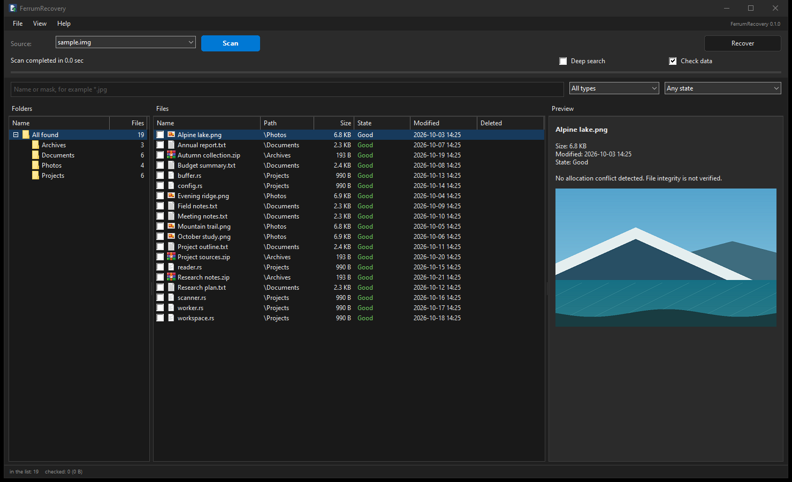

# FerrumRecovery

[](https://github.com/dyrb/ferrumrecovery/actions/workflows/ci.yml)
[](https://github.com/dyrb/ferrumrecovery/releases/latest)
[](#license)


Deleted-file recovery for Windows, written in Rust with a native Win32 interface and
command-line tools. Reads NTFS, FAT12/16/32 and exFAT from volumes, physical disks and
images.

[Русская версия](README.ru.md)



## Features

- Deleted NTFS records, resident data, fragmented and sparse streams, LZNT1 compression,
  attribute lists and alternate data streams.
- Deleted FAT and exFAT directory entries, disconnected folders and surviving structures
  from older file systems.
- Recycle Bin original names and paths, NTFS change-journal and directory-index traces,
  and existing Windows shadow-copy sources.
- MBR/GPT partition discovery, including backup tables and file-system boot sectors.
- Signature search for images, documents, archives, audio and video, including CAB and
  PCX/DCX. Custom signatures are available through the CLI.
- Folder tree, virtual file list, masks, type/date/size/state filters, checked selection,
  CSV export and saved scans.
- Image, text and hex previews. PNG, JPEG, BMP, GIF, TIFF and ICO are decoded through
  Windows imaging components.
- Resumable source imaging, scan pause/cancellation, English and Russian, system light
  and dark themes.
- Portable GUI and CLI. Preferences are saved in `FerrumRecovery.ini` beside the program.
  Images, progress maps, saved scans and reports are written only to chosen destinations.

The screenshot uses a synthetic disk image with sample documents and pictures.

## Usage

Download the ZIP from [Releases](https://github.com/dyrb/ferrumrecovery/releases/latest), extract
it and run `ferrumrecovery-gui.exe`. Requires Windows 10 or 11, x64. The GUI requests
administrator rights; the CLI needs elevation for direct disk access.

1. Choose a volume, physical disk or image. Raw images and fixed VHD are supported.
2. Select a mode in **View > Search mode**, then press **Scan**.
3. Select or check files, press **Recover** and choose a folder on another volume.

| Mode | Reads |
| --- | --- |
| Quick | File-system metadata |
| Deep | Metadata and free space, including signature search |
| Full | Metadata and the entire selected range, including allocated space and old structures |

For partitioned disks, choose one partition or the entire source. Full search reads the
whole selected range and then resolves candidates; elapsed time includes these stages.

Checked files take precedence over selected rows. Filters retain checkmarks. Existing
output files are never overwritten. **View** contains language, theme, preview mode and
analysis filters. **File > Create source image** makes an image with a resumable `.map`.

Sources are opened read-only. Store the program and recovered files on another drive.
For damaged media, work from an image on a healthy disk. Preferences are written only
when changed; scans are not cached automatically.

### Command line

In these examples `disk1` is the source and `D:\Recovery` is an existing folder on
another volume. Use `disks` and `partitions` to find the correct source and partition.

```powershell
# List available sources and the partitions on a physical disk.
.\ferrumrecovery.exe disks
.\ferrumrecovery.exe partitions disk1

# Search the entire first partition, sample file contents and save the scan.
.\ferrumrecovery.exe scan disk1 --part 1 --full --check --save D:\Recovery\scan.frs

# List every JPEG candidate from a saved scan without scanning again.
.\ferrumrecovery.exe scan D:\Recovery\scan.frs --name '*.jpg' --limit 0

# Recover matching files to another volume, preserving known folder paths.
.\ferrumrecovery.exe recover D:\Recovery\scan.frs --name '*.jpg' --to D:\Recovery\restored

# Copy a whole source to an image; repeating the command resumes from its map.
.\ferrumrecovery.exe image disk1 --to D:\Recovery\disk1.img
```

Run `ferrumrecovery.exe --help` for all commands and filters. Saved scans can be opened
without repeating the scan; preview and recovery still require the original source.

## Building from source

1. Install [Build Tools for Visual Studio](https://visualstudio.microsoft.com/visual-cpp-build-tools/)
   with **Desktop development with C++**, the Windows SDK and MSVC linker.
2. Install Rust through [rustup.rs](https://rustup.rs) using the MSVC toolchain. Rust 1.88
   or newer is required.
3. Download the source ZIP or clone this repository, then run in its folder:

   ```powershell
   cargo build --release --workspace --locked
   ```

The executables are `target\release\ferrumrecovery-gui.exe` and
`target\release\ferrumrecovery.exe`. All engine components and normal test fixtures are
included. External crates are `windows-sys`, `windows-link` and `memchr`.

`scripts\build-release.ps1` builds the executables and creates a ZIP with a SHA-256
checksum in `dist`. Personal settings and intermediate build files are excluded.

Checks:

```powershell
cargo fmt --all --check
cargo clippy --workspace --all-targets --locked -- -D warnings
cargo test --workspace --locked
```

## Recovery details

`fr-core` handles read-only I/O, data streams, signature carving, saved scans, imaging and
recovery. `fr-ntfs` and `fr-fat` parse file systems; `fr-scan` coordinates scan stages and
merges findings. The GUI and CLI share these components. Full search overlaps queued
reads and parsing with bounded reusable buffers, then resolves file boundaries.

**Good** means no detected allocation conflict under the available metadata. Sampled
checks do not verify every byte. An SSD may already have discarded deleted data.
Unreadable ranges are reported and filled with zeros. A live source can change after
scanning; saved results do not freeze its contents.

Counts include candidates, overlapping alternatives and text fragments, not just unique
intact files. Signature matches have unknown deletion status. Text fragments can come
from existing files and lack original boundaries. **Lost files** have no reliable parent
path; this is independent of the condition of their data.

Signature search assumes contiguous content; fragmented recovery needs surviving metadata.
Deep tests cluster boundaries, Full uses a 512-byte step, and other start alignments can
be missed. Some file boundaries are estimated. FAT deletion often destroys cluster chains.
Historical reconstruction depends on surviving structures; reached candidate limits are
reported. Missing allocation information remains **Undetermined**.

Image previews accept encoded files up to 64 MB and 100 million pixels, showing the first
frame of multi-frame formats. Text and hex show the first 1 MB. CAB recovery retains the
container without repairing missing cabinet volumes or damaged compressed members.

EFS decryption, ReFS, RAID assembly and Linux/macOS file systems are not supported.
Dynamic VHD and VHDX must be attached through Windows first. Recovery on failing physical
media has not been validated for this release.

## Credits

Developed by [dyrb](https://github.com/dyrb), with contributions from Claude and Codex.
Disk-reading, NTFS and interface code is adapted from
[FerrumTree](https://github.com/dyrb/ferrumtree).
See also [FerrumCompare](https://github.com/dyrb/ferrumcompare).

## License

Licensed under either [Apache License 2.0](LICENSE-APACHE) or [MIT](LICENSE-MIT), at your option.

Third-party license notices: [THIRD_PARTY_NOTICES.md](THIRD_PARTY_NOTICES.md).
