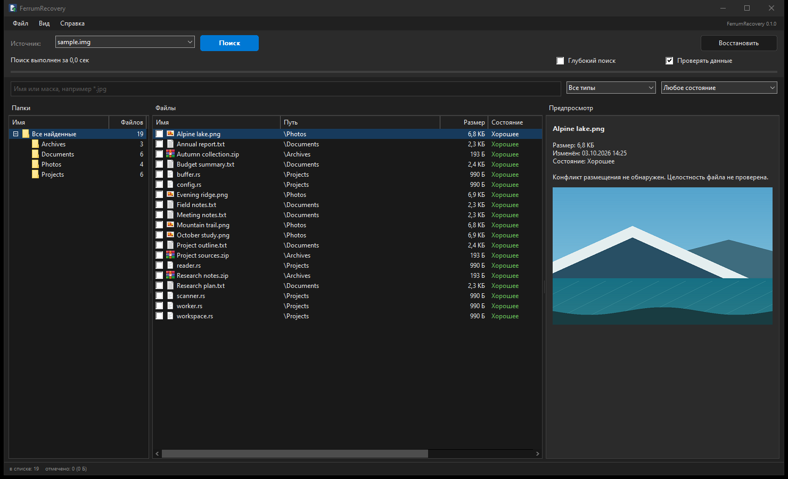

# FerrumRecovery

[](https://github.com/dyrb/ferrumrecovery/actions/workflows/ci.yml)
[](https://github.com/dyrb/ferrumrecovery/releases/latest)
[](#лицензия)


Восстановление удалённых файлов для Windows. Написано на Rust с нативным интерфейсом
Win32 и командной строкой. Читает NTFS, FAT12/16/32 и exFAT на томах, физических дисках
и в образах.

[English version](README.md)



## Возможности

- Удалённые записи NTFS, резидентные данные, фрагментированные и разреженные потоки,
  сжатие LZNT1, списки атрибутов и альтернативные потоки данных.
- Удалённые записи каталогов FAT и exFAT, потерянные папки и сохранившиеся структуры
  прежних файловых систем.
- Исходные имена и пути из Корзины, следы из журнала изменений и индексов каталогов
  NTFS, чтение существующих теневых копий Windows.
- Поиск разделов MBR/GPT, включая резервные таблицы и загрузочные секторы файловых систем.
- Поиск по сигнатурам изображений, документов, архивов, аудио и видео, включая CAB и
  PCX/DCX. Через CLI можно подключить свои сигнатуры.
- Дерево папок, виртуальный список файлов, маски, фильтры по типу, дате, размеру и
  состоянию, отметки файлов, экспорт CSV и сохранение результатов поиска.
- Предпросмотр изображений, текста и hex. PNG, JPEG, BMP, GIF, TIFF и ICO декодируются
  средствами Windows.
- Создание образа с продолжением после остановки, пауза и отмена поиска, русский и
  английский интерфейс, светлая, тёмная и системная темы.
- Портативные GUI и CLI. Настройки находятся в `FerrumRecovery.ini` рядом с программой.
  Образы, карты копирования, результаты поиска и отчёты сохраняются по выбранному пути.

На скриншоте используется синтетический образ диска с примерами документов и изображений.

## Использование

Скачайте ZIP из [Releases](https://github.com/dyrb/ferrumrecovery/releases/latest), распакуйте
и запустите `ferrumrecovery-gui.exe`. Требуется Windows 10 или 11, x64. GUI запрашивает
права администратора; CLI требует повышения прав для прямого доступа к дискам.

1. Выберите том, физический диск или образ. Поддерживаются сырые образы и фиксированные VHD.
2. Выберите режим в **Вид > Режим поиска** и нажмите **Поиск**.
3. Выделите или отметьте файлы, нажмите **Восстановить** и выберите папку на другом томе.

| Режим | Что читает |
| --- | --- |
| Быстрый | Метаданные файловой системы |
| Глубокий | Метаданные и свободное пространство, включая поиск по сигнатурам |
| Полный | Метаданные и весь выбранный диапазон, включая занятое место и старые структуры |

На диске с разделами можно выбрать отдельный раздел или весь источник. Полный поиск
читает весь выбранный диапазон, затем уточняет находки; итоговое время включает эти этапы.

Отмеченные файлы имеют приоритет над выделенными строками. Фильтры сохраняют отметки.
Существующие файлы назначения не перезаписываются. В меню **Вид** находятся язык, тема,
режим предпросмотра и фильтры анализа. **Файл > Создать образ источника** создаёт образ
с картой `.map` для продолжения копирования.

Источник открывается только для чтения. Храните программу и восстановленные файлы на
другом диске. При повреждении носителя работайте с его образом на исправном диске.
Настройки записываются только при изменении; автоматического кэша поиска нет.

### Командная строка

В примерах `disk1` является источником, а `D:\Recovery` является существующей папкой
на другом томе. Команды `disks` и `partitions` помогут определить нужный диск и раздел.

```powershell
# Показать доступные источники и разделы физического диска.
.\ferrumrecovery.exe disks
.\ferrumrecovery.exe partitions disk1

# Полностью просканировать первый раздел, проверить образцы данных и сохранить результаты.
.\ferrumrecovery.exe scan disk1 --part 1 --full --check --save D:\Recovery\scan.frs

# Показать всех кандидатов JPEG из сохранённых результатов без повторного поиска.
.\ferrumrecovery.exe scan D:\Recovery\scan.frs --name '*.jpg' --limit 0

# Восстановить подходящие файлы на другой том с сохранением известных путей папок.
.\ferrumrecovery.exe recover D:\Recovery\scan.frs --name '*.jpg' --to D:\Recovery\restored

# Скопировать весь источник в образ; повтор команды продолжает копирование по карте.
.\ferrumrecovery.exe image disk1 --to D:\Recovery\disk1.img
```

Все команды и фильтры: `ferrumrecovery.exe --help`. Сохранённые результаты открываются
без повторного поиска; для предпросмотра и восстановления нужен исходный носитель.

## Сборка из исходного кода

1. Установите [Build Tools for Visual Studio](https://visualstudio.microsoft.com/visual-cpp-build-tools/)
   с набором **Разработка классических приложений на C++**, Windows SDK и компоновщиком MSVC.
2. Установите Rust через [rustup.rs](https://rustup.rs) с инструментами MSVC. Нужен Rust 1.88
   или новее.
3. Скачайте ZIP исходников или клонируйте репозиторий и выполните в его папке:

   ```powershell
   cargo build --release --workspace --locked
   ```

Программы появятся в `target\release\ferrumrecovery-gui.exe` и
`target\release\ferrumrecovery.exe`. Все компоненты движка и фикстуры обычных тестов
включены. Внешние crates: `windows-sys`, `windows-link` и `memchr`.

`scripts\build-release.ps1` собирает программы и создаёт ZIP с контрольной суммой SHA-256
в `dist`. Личные настройки и промежуточные файлы сборки в архив не включаются.

Проверки:

```powershell
cargo fmt --all --check
cargo clippy --workspace --all-targets --locked -- -D warnings
cargo test --workspace --locked
```

## Особенности восстановления

`fr-core` отвечает за чтение источника, потоки данных, сигнатуры, сохранение результатов,
образы и восстановление. `fr-ntfs` и `fr-fat` разбирают файловые системы; `fr-scan`
управляет этапами поиска и объединяет находки. GUI и CLI используют общий движок.
Полный поиск совмещает чтение через очередь с разбором данных в ограниченном наборе
повторно используемых буферов, затем уточняет границы файлов.

**Хорошее** означает отсутствие обнаруженного конфликта размещения по доступным
метаданным. Выборочная проверка не проверяет каждый байт. SSD мог уже отбросить удалённые
данные. Непрочитанные области отмечаются и заполняются нулями. Работающий том может
измениться после поиска; сохранение результатов не фиксирует его содержимое.

Счётчики включают кандидатов, пересекающиеся варианты и текстовые фрагменты, а не только
уникальные целые файлы. Для сигнатурных находок неизвестен факт удаления. Текстовые фрагменты
могут происходить из существующих файлов и не иметь исходных границ. **Потерянные файлы**
не имеют надёжного пути к родительской папке; это не определяет состояние их данных.

Сигнатурный поиск предполагает непрерывное размещение; для фрагментированных файлов нужны
метаданные. Глубокий режим проверяет границы кластеров, полный использует шаг 512 байт,
другие смещения могут быть пропущены. Некоторые границы определяются приблизительно.
В FAT при удалении часто теряется цепочка кластеров. Поиск старых структур зависит от
сохранившихся данных; достижение лимитов кандидатов сопровождается предупреждением.
Недоступные сведения о размещении дают состояние **Не определено**.

Предпросмотр принимает изображения до 64 МБ и 100 млн пикселей, показывая первый кадр
многостраничных форматов. Для текста и hex читается первый 1 МБ. CAB восстанавливается
как контейнер без исправления отсутствующих томов архива и повреждённых сжатых элементов.

Расшифровка EFS, ReFS, сборка RAID, файловые системы Linux и macOS не поддерживаются.
Динамические VHD и VHDX нужно предварительно подключить средствами Windows.
Этот выпуск не проходил проверку восстановления на неисправных физических носителях.

## Авторы

Разработчик: [dyrb](https://github.com/dyrb), при участии Claude и Codex.
Чтение дисков, NTFS и основа интерфейса адаптированы из
[FerrumTree](https://github.com/dyrb/ferrumtree).
Другой проект: [FerrumCompare](https://github.com/dyrb/ferrumcompare).

## Лицензия

[Apache License 2.0](LICENSE-APACHE) или [MIT](LICENSE-MIT), на ваш выбор.

Уведомления о сторонних библиотеках: [THIRD_PARTY_NOTICES.md](THIRD_PARTY_NOTICES.md).
